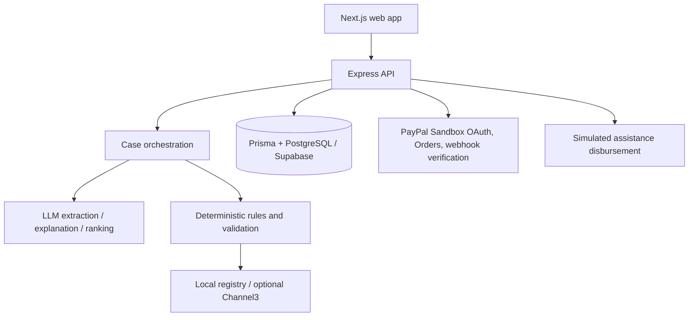

# LIFELINE

**AI-Powered Humanitarian Financial Access and Payment Coordination Network**

> Money should reach people. Access should reach them too.

LIFELINE is a humanitarian assistance coordination prototype. An NGO worker records a family’s needs and financial access constraints; the application structures the report, evaluates available payment routes, and builds a budget-aware basket of essentials. An NGO coordinator reviews and approves an assistance allocation. Donors can fund an approved allocation through PayPal Sandbox.

AI extracts, explains, and ranks. Deterministic backend rules validate amounts, currencies, budgets, eligibility, and state transitions. NGO approval controls allocation authorization. PayPal Sandbox handles the donor checkout only: the application does not send PayPal payouts to beneficiaries. Its assistance disbursement endpoint is an explicitly simulated internal state.

## Current status

The main case, finance, commerce, NGO approval, donation, and dashboard flows are implemented. The API supports PayPal Sandbox order creation, capture validation, cancellation, and signature-verified webhook processing. Channel3 product search is optional and falls back to a local synthetic registry.

Two deployment/live-verification items remain:

- PayPal Sandbox buyer approval for EUR currently fails with `UNSUPPORTED_PAYEE_CURRENCY`, even though OAuth and EUR order creation succeed and the configured German Sandbox seller has EUR as its primary currency. No successful capture has been established for that failing checkout.
- Live webhook delivery requires a deployed public HTTPS endpoint, webhook registration in the PayPal Sandbox app, `PAYPAL_WEBHOOK_ID`, and a delivery test.

The simulated disbursement is not a real PayPal transfer or proof of aid delivery. There is no authentication or role-based access control in this MVP. See the [complete project overview](docs/LIFELINE_PROJECT_OVERVIEW.md) for detailed implementation notes, state transitions, API routes, limitations, and evidence.

## Member divisions

| Member | Primary responsibilities |
| --- | --- |
| **Member 1 — Athira V** | Situation Intelligence: Situation Agent extraction and validation, case orchestration and persistence, situation flow, and case dashboard/review experience. |
| **Member 2 — Fathima Mehrin V S** | Financial Intelligence: deterministic fee, accessibility, and route eligibility rules; finance assessment and explanations; NGO allocation approval; PayPal webhook verification; and simulated assistance disbursement. |
| **Member 3 — Asiya Muhammed Sali** | Commerce and donor checkout: product sources and Channel3/local fallback, ranking and budget basket construction, allocation-linked donations, PayPal Sandbox order/capture/cancellation flow, and donation UI. |

These are the project’s implementation areas. The end-to-end workflow and shared API/contracts connect the work across members.

## End-to-end flow

```text
Situation report
      ↓
Situation Agent extracts needs and missing information
      ↓
Deterministic finance and accessibility rules
      ↓
Commerce sources + ranking → budget-aware basket
      ↓
Persisted assistance case → NGO review and approval
      ↓
Donation linked to approved allocation → PayPal Sandbox order
      ↓
Buyer approval → backend capture validation / verified webhook
      ↓
Captured funds can support an explicitly simulated disbursement
      ↓
NGO coordinates actual assistance outside this application
```

The beneficiary does not need to shop online, use PayPal, or receive PayPal funds. A browser redirect alone does not mean a donation was captured.

## AI and decision boundaries

| Component | Purpose | Deterministic controls |
| --- | --- | --- |
| Situation Agent | Extract structured needs, location, budget, urgency, access factors, and missing information from a report | Output is validated and post-processed; missing required facts can stop the workflow for clarification. |
| Finance explanation | Explain a route assessment | Route fees, usable value, accessibility scores, and eligibility outcomes are calculated by backend rules. |
| Commerce ranking | Rank eligible product candidates and provide reasons | Product IDs are checked against candidates; basket needs, quantities, currency, reserve, and budget are enforced by code. |

The supported LLM providers use an OpenAI-compatible client: Groq and optionally Gemini. Provider/model credentials are configured on the API server. If an LLM call fails, finance explanation and commerce ranking have deterministic fallbacks; situation extraction requires an available provider and otherwise returns an error rather than fabricating extracted facts.

## Commerce and assistance

Commerce uses a local synthetic product registry and can optionally search Channel3 at `POST https://api.trychannel3.com/v1/search` with server-side `x-api-key` authentication. Channel3 results are normalized and validated; missing configuration or upstream errors leave the local products available. Prices are estimates, not guaranteed offers or stock.

The basket builder uses integer-cent arithmetic, validates currency and budget, applies the configured reserve, selects at most one item per need, and returns alternatives and unmet needs. NGO approval requires an eligible persisted assistance case and basket, a valid amount/currency, and a matching active campaign. Approval does not mean that the allocation is funded; funding is recorded through the donation/payment lifecycle.

## PayPal and disbursement

PayPal credentials and API calls are server-side. The application is configured for the PayPal Sandbox base URL. Donation creation validates an approved allocation before creating an order. Capture checks the PayPal order status, capture ID, amount, and currency before persisting `CAPTURED`. Cancellation is tied to the specific donation and cannot overwrite a successful capture. Verified webhook events are idempotent and protected against terminal-state regressions.

The webhook endpoint is `POST /api/payments/webhooks/paypal`. It preserves raw request bytes, requires PayPal transmission headers and `PAYPAL_WEBHOOK_ID`, and calls PayPal’s verification API. It handles `CHECKOUT.ORDER.APPROVED`, `PAYMENT.CAPTURE.COMPLETED`, and `PAYMENT.CAPTURE.DENIED`. Automated tests mock PayPal verification; live webhook registration/delivery is still pending deployment.

The payout endpoint records only a simulated assistance disbursement after verifying an approved allocation and sufficient captured donations. It does not call a PayPal Payouts API and does not claim that a beneficiary received money.

## Main screens

| Page | Purpose |
| --- | --- |
| `/` | Project landing page and entry point. |
| `/situation` | Record or review a situation and structured needs. |
| `/finance` | Inspect financial route and accessibility analysis. |
| `/commerce` | Build a commerce basket from needs and budget. |
| `/dashboard` | Review cases, approve eligible allocations, and request simulated disbursement. |
| `/donate` | Fund a selected approved allocation through PayPal Sandbox. |
| `/donate/return` | Ask the API to capture the returned order and show the verified result. |

The dashboard is a demo UI, not a secured NGO portal. See the [API contracts](docs/api-contracts.md) and [PayPal integration notes](docs/paypal-integration.md) for more details.

## Architecture



## Repository layout

```text
apps/web/                 Next.js frontend pages and UI
apps/api/src/             Express API, AI, routes, rules, modules, integrations
  ai/                     LLM clients and provider configuration
  modules/                situation, finance, commerce, and assistance services
  orchestration/          Case workflow
  rules/                  Deterministic financial and eligibility rules
  integrations/            PayPal and Channel3 clients/adapters
packages/contracts/       Shared request/response schemas and types
prisma/                   Prisma schema, migrations, and seed
tests/                    Unit and integration tests
postman/                  API request collection
docs/                     Architecture, integration, API, and project references
```

## Requirements and setup

- Node.js 22 or later
- PostgreSQL/Supabase for persisted cases, baskets, allocations, donations, and audit data
- PayPal Sandbox app credentials for donation checkout
- An LLM provider/model pair for Situation Agent extraction; LLM credentials are otherwise optional for API startup
- Channel3 key is optional; local products remain available without it

```bash
npm install
cp .env.example .env
# Set the required values in .env; keep secrets server-side and out of Git.
npm run db:validate
npm run db:migrate
npm run db:seed
npm run dev
```

`npm run dev` starts the API and web app together. The API defaults to port 4000 and the web app to port 3000. `npm run db:migrate` runs Prisma’s development migration command; use the deployment migration workflow for deployed environments. Do not run a reset against a database with data you need to keep.

### Important environment variables

| Variable | Purpose |
| --- | --- |
| `DATABASE_URL` | Prisma application database connection. |
| `DIRECT_URL` | Direct database connection used by Prisma configuration/seed when provided. |
| `LLM_PROVIDER` | Selects the preferred supported LLM provider. |
| `GROQ_API_KEY`, `GROQ_MODEL` | Groq provider configuration. |
| `GEMINI_API_KEY`, `GEMINI_MODEL` | Optional Gemini provider/fallback configuration. |
| `CHANNEL3_API_KEY` | Optional server-side Channel3 product search. |
| `PAYPAL_CLIENT_ID`, `PAYPAL_CLIENT_SECRET` | Server-side PayPal Sandbox OAuth credentials. |
| `PAYPAL_BASE_URL` | PayPal API base URL; payment routes require the Sandbox host. |
| `PAYPAL_WEBHOOK_ID` | Registered webhook ID required to verify incoming webhook requests. |
| `WEB_ORIGIN` | API CORS origin. |
| `NEXT_PUBLIC_API_URL` | API base URL used by the web app; do not put secrets in `NEXT_PUBLIC_*`. |

Use `.env.example` for the repository’s current template. Never commit `.env` or expose server credentials through frontend configuration.

## Useful commands

| Command | Purpose |
| --- | --- |
| `npm run dev` | Run API and web app together. |
| `npm run dev:api` / `npm run dev:web` | Run one application. |
| `npm test` | Run the Vitest suite. |
| `npm run typecheck` | Type-check workspaces and root TypeScript. |
| `npm run build` | Run available workspace production builds. |
| `npm run db:validate` | Validate Prisma schema. |
| `npm run db:generate` | Generate Prisma client. |
| `npm run db:migrate` | Run Prisma migrate dev. |
| `npm run db:seed` | Seed demo NGO/campaign data. |
| `npm run db:studio` | Open Prisma Studio. |

Tests mock external services and do not perform live PayPal, Channel3, LLM, or production database calls. See [tests/README.md](tests/README.md) for test coverage notes.

## Known limitations

- PayPal is Sandbox-only; the current EUR approval failure is `UNSUPPORTED_PAYEE_CURRENCY` and its PayPal-side receiving/eligibility cause remains unresolved.
- Live PayPal webhook registration and public HTTPS delivery verification remain deployment tasks.
- Assistance disbursement is simulated; actual payments to aid recipients and delivery confirmation are outside this MVP.
- The project has no authentication or role-based authorization.
- Product registry entries and demo humanitarian data are synthetic; Channel3 price/availability data is external and may not represent local stock.
- The demo dashboard is not suitable as a production NGO case-management portal.

## Further documentation

- [Complete project overview and developer reference](docs/LIFELINE_PROJECT_OVERVIEW.md)
- [Authentication foundation and role model](docs/authentication.md)
- [Architecture](docs/architecture.md)
- [AI design](docs/ai-design.md)
- [PayPal integration](docs/paypal-integration.md)
- [Integration status](docs/integration-status.md)
- [API contracts](docs/api-contracts.md)
- [Git workflow](docs/git-workflow.md)
- [Member handoffs](docs/handoffs/)

## Licence

[MIT](LICENSE)
