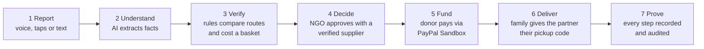
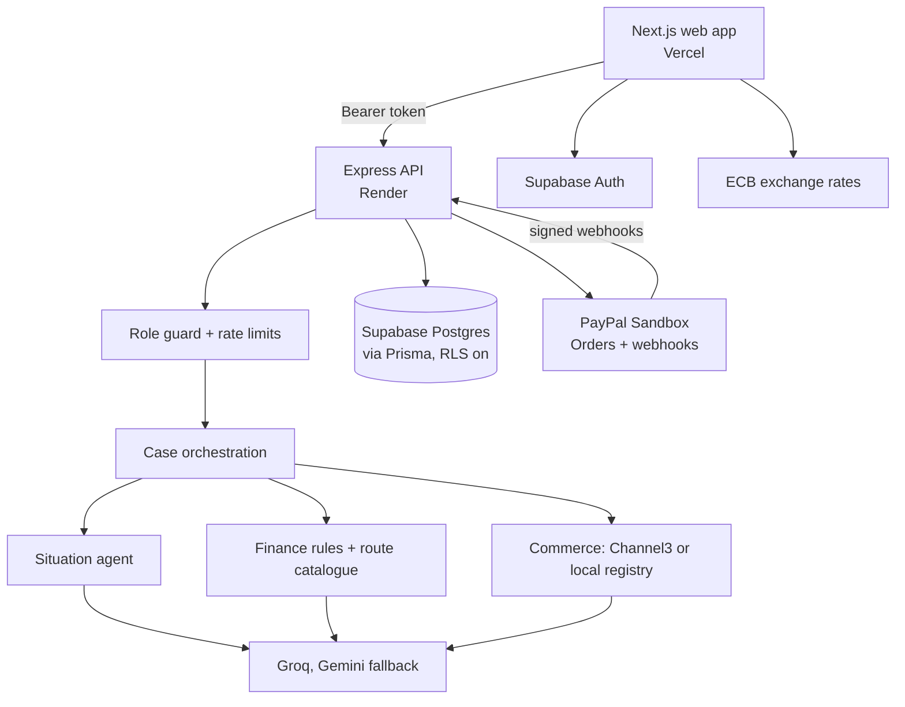

# LIFELINE

**From emergency report to verified aid delivery.**

> AI understands, rules verify, NGOs decide, donors fund, partners deliver.
> LIFELINE never decides who deserves aid.

LIFELINE helps small NGOs turn a messy emergency report into a verified, costed, NGO-approved aid plan that donors can
fund through PayPal, and it records every step until the goods reach the family. Families need no bank account, no
PayPal account and no LIFELINE login.

**Live app:** https://lifeline-pay-pal-ai-hackathon-wwr2.vercel.app
**API:** https://lifeline-api-i269.onrender.com/health (free hosting sleeps when idle; the first request can take up to a minute)

---

## Contents

- [The problem](#the-problem)
- [How LIFELINE works](#how-lifeline-works)
- [Who uses it](#who-uses-it)
- [Main screens](#main-screens)
- [What is real, sandboxed and simulated](#what-is-real-sandboxed-and-simulated)
- [AI and decision boundaries](#ai-and-decision-boundaries)
- [Security and privacy](#security-and-privacy)
- [Architecture](#architecture)
- [Tech stack](#tech-stack)
- [Run it locally](#run-it-locally)
- [Environment variables](#environment-variables)
- [Commands](#commands)
- [Deployment](#deployment)
- [Testing](#testing)
- [Repository layout](#repository-layout)
- [Team](#team)
- [Known limitations](#known-limitations)
- [Further documentation](#further-documentation)

---

## The problem

Small NGOs receive emergency requests by phone and chat, in incomplete language: *"We lost our food in the flood, the
bank is closed, my son needs medicine."* Someone then has to work out what the family needs, how help can actually reach
them, what it costs, and who can supply it. Donors want to know where their money went.

Sending money is not the same as getting aid to a family. A transfer can succeed while the bank is closed, cash agents
charge 20% and local shops can't take the payment.

## How LIFELINE works



| # | Step | Who | What happens |
|---|---|---|---|
| 1 | **Report** | Family, relative or NGO worker | One question per screen: what happened, where, how many people, how urgent. Speak, type or tap. |
| 2 | **Understand** | AI, then rules | The AI extracts needs, urgency and practical access (bank, ATM, wallet, cash, shops, signal). Anything not said stays **unknown**, and only questions that block a decision are asked. |
| 3 | **Verify** | Rules | Code compares delivery routes (bank, PayPal, cash agent, local partner) on fees, usable value and access, then builds a capped basket of essentials. |
| 4 | **Decide** | NGO reviewer | A person approves the plan and picks an approved supplier. The amount is worked out from the basket and route, and a purchase order is created. AI cannot approve anything. |
| 5 | **Fund** | Donor | The donor sees an anonymised plan and pays through PayPal Sandbox. The server confirms the capture with PayPal, and PayPal's signed webhook confirms it again. |
| 6 | **Deliver** | NGO, family, partner | The NGO creates a one-time pickup code and gives it to the family by phone, SMS or on paper. The partner never sees it. At collection the family gives the code to the partner, who must enter it to record the handover; wrong codes are counted and lock after five. The NGO then confirms the delivery. |
| 7 | **Prove** | Everyone | Donors see only recorded steps. A captured donation is never shown as a supplier payment or a delivery. |

## Who uses it

| Role | How they get it | Can do |
|---|---|---|
| **Family** | No account needed | Report a need. |
| **Donor** | Automatic for every new account | Fund approved plans and follow their progress. Sees no family details. |
| **Partner** | Given by NGO staff on **Team & Access** | Record preparation and handover for deliveries assigned to them. |
| **NGO staff** | Given by NGO staff on **Team & Access** | Review cases, verify suppliers, approve plans, manage payments, deliveries and access. |
| **LIFELINE Admin** | Given by an Admin on **Manage Accounts** | Manage every account, including other Admins. |

Each role starts on its own page: NGO staff on **Overview**, donors on **Approved Plans**, partners on **Delivery
Tracking** and Admins on **Manage Accounts**.

## Main screens

| Screen | Path | For | Purpose |
|---|---|---|---|
| Home | `/` | Everyone | What LIFELINE does and how to start. |
| Request assistance | `/situation` | Signed-in users | One-question-per-screen report, AI review, then submit. |
| Overview | `/overview` | NGO | Urgent cases, alerts, funding and recent activity. |
| Assistance Cases | `/dashboard` | NGO | AG Grid of cases: urgency, risk, route, basket, funding, supplier, delivery and approval. |
| Case detail | `/dashboard/[id]` | NGO | Full assessment and a timeline of recorded steps. |
| Financial Assessments | `/finance` | NGO | Route comparison: fees, usable value and access for each option. |
| Product Baskets | `/commerce` | NGO | The essentials chosen for a case, and a quick planner. |
| Suppliers | `/suppliers` | NGO | Directory with performance scores. Each supplier has a six-point **verification checklist** that must be complete before approval. |
| Payments | `/payments` | NGO | Donations in and supplier payments out, kept separate. |
| Delivery Tracking | `/deliveries` | NGO, partner | Assign partners, create the family's pickup code, record the handover with it, confirm delivery. |
| Audit Logs | `/audit` | NGO | Who did what and when, plus supplier incidents. |
| Team & Access | `/team` | NGO | Give partner or NGO access. Every change is audited. |
| Approved Plans | `/plans` | Donor, NGO | Anonymised plans with funding progress. |
| My Contributions | `/contributions` | Donor | A donor's gifts and every recorded step since. |
| Donate | `/donate` | Donor, NGO | PayPal Sandbox checkout for one approved plan. |
| Manage Accounts | `/admin/users` | Admin | Assign any role. |
| Profile | `/profile` | Everyone | Account details and **display currency**. |

**Display currency:** amounts are shown in each viewer's own currency, for example "≈ ₹2,633 (€25.00)" for someone in
India, using daily European Central Bank rates. It is detected from the visitor's country, time zone or browser
language, and can be changed on Profile. Payments always stay in the plan's own currency (EUR).

## What is real, sandboxed and simulated

| Part | Status | Notes |
|---|---|---|
| Groq LLM | **Real** | Situation analysis, route explanations and product ranking. A Gemini fallback is built and needs `GEMINI_API_KEY`. |
| Supabase Postgres and Auth | **Real** | All records, sign-in, and roles. Row-level security is on for every table. |
| Channel3 product search | **Real** | Used first, with a synthetic local registry as fallback. |
| Exchange rates | **Real** | European Central Bank reference rates, display only. |
| PayPal Orders and webhooks | **Sandbox-tested** | A €25 donation was captured, and both webhooks arrived signature-verified on the deployed API. |
| Purchase orders, delivery, pickup codes | **Sandbox-tested** | A funded plan was assigned, prepared, handed over and confirmed end to end on 11 Nov. |
| Supplier payment | **Simulated** | Recorded against the purchase order and labelled. No money is sent. |
| Suppliers, routes and fees | **Synthetic** | Labelled "(synthetic)" or "illustrative" in the UI. |

The full, dated list is in [docs/integration-status.md](docs/integration-status.md).

## AI and decision boundaries

| AI does | Code and people do |
|---|---|
| Extract needs, urgency and access facts from a report | Validate every AI reply against a schema; reject anything that doesn't fit |
| Explain why a route was chosen, in plain language | Calculate fees, usable value, eligibility and risk |
| Rank candidate products | Enforce quantities, budget, reserve and currency |
| Read text in other languages | Approve plans (a person), verify suppliers (a person), confirm payments (PayPal) |

- AI output is untrusted until it passes the contract and the rules.
- Missing facts stay **unknown**. The AI never fills a gap with a guess.
- If explanation or ranking fails, deterministic fallbacks take over. If extraction fails, the app says so instead of
  inventing facts.
- The accessibility score explains a decision; it never denies aid or lowers priority.

## Security and privacy

- **Families are protected.** Donor pages and `/api/plans` never return a name, location, photo or the family's own
  words. The database query selects only safe fields, and tests check this.
- **Server-side authorization.** Every API request verifies the Supabase token on the server, and roles come from the
  database, never from the browser.
- **Row-level security** is on for every table, so the public Supabase key that browsers receive reads no rows.
- **Least privilege.** Nobody can give themselves more access. NGO staff can't change their own role or an Admin's.
- **Rate limits.** 6 reports a minute per account (each uses AI), 30 sign-in calls a minute and 240 API calls a minute
  per address.
- **Security headers** on the API and the website, and the framework banner is hidden.
- **Payments.** PayPal credentials stay on the server, payment amounts are re-checked against PayPal, and webhooks are
  signature-verified.
- **Audit.** Approvals, supplier checks, access changes, pickup-code attempts and payments are recorded with who and when.
- **Synthetic data only.** No real person's details are used anywhere in the demo.

## Architecture



The web app never talks to the database directly. It signs in with Supabase, then sends the token to the API, which
checks it with Supabase and loads the user's role from the database.

## Tech stack

| Layer | Technology |
|---|---|
| Web | Next.js 16 (App Router), React, TypeScript, Tailwind CSS v4, AG Grid Community |
| API | Node.js 22, Express, Zod |
| Shared contracts | `@lifeline/contracts`: Zod schemas used by both apps |
| Database | Supabase Postgres, Prisma 7 |
| Auth | Supabase Auth (email and password) |
| AI | Groq (OpenAI-compatible API), optional Gemini fallback |
| Payments | PayPal Orders v2 and Webhooks (Sandbox) |
| Products | Channel3 search API, local synthetic registry |
| Exchange rates | European Central Bank reference rates via Frankfurter |
| Hosting | Render (API), Vercel (web) |
| Tests | Vitest, Supertest |

## Run it locally

Requirements: Node.js 22 or later, a Supabase project, a Groq API key and PayPal Sandbox app credentials. Channel3 and
Gemini are optional.

```bash
npm install
cp .env.example .env                    # API and database settings
# create apps/web/.env.local with the three NEXT_PUBLIC_* values listed below
npx prisma migrate deploy               # apply migrations (never use migrate dev on a shared database)
npm run db:seed                         # demo campaign and synthetic suppliers
npm run dev                             # API on :4000, web on :3000
```

Then create an account at http://localhost:3000/login. New accounts are donors. To make your first NGO account, run:

```bash
npm run auth:assign-role --workspace @lifeline/api -- <supabase-auth-user-id> NGO
```

After that, NGO staff can give access from **Team & Access** in the app.

## Environment variables

Secrets live only in `.env` (API) and `apps/web/.env.local` (web), and both are ignored by Git. Never put a secret in a
`NEXT_PUBLIC_*` variable, and never put the Supabase service-role key in the web app.

**API (`.env`)**

| Variable | Required | Purpose |
|---|---|---|
| `DATABASE_URL` | Yes | Supabase transaction pooler (port 6543), used by the API. |
| `DIRECT_URL` | Yes | Supabase session connection (port 5432), used by Prisma migrations. |
| `SUPABASE_URL`, `SUPABASE_ANON_KEY` | Yes | Lets the API verify sign-in tokens. |
| `SUPABASE_SERVICE_ROLE_KEY` | Local only | Used by admin scripts (role assignment, password reset). Never deploy it to the web app. |
| `WEB_ORIGIN` | Yes | The exact website address allowed to call the API, with no trailing slash. |
| `LLM_PROVIDER`, `GROQ_API_KEY`, `GROQ_MODEL` | Yes | The AI provider. |
| `GEMINI_API_KEY`, `GEMINI_MODEL` | Recommended | Backup AI if Groq is rate-limited. |
| `CHANNEL3_API_KEY` | Optional | Live product search. |
| `PAYPAL_CLIENT_ID`, `PAYPAL_CLIENT_SECRET` | Yes | PayPal Sandbox app credentials. |
| `PAYPAL_BASE_URL` | Yes | Must be `https://api-m.sandbox.paypal.com`. |
| `PAYPAL_WEBHOOK_ID` | For webhooks | The webhook ID from the PayPal Sandbox app. |

**Web (`apps/web/.env.local`)**

| Variable | Purpose |
|---|---|
| `NEXT_PUBLIC_API_URL` | The API address, for example `http://localhost:4000`. |
| `NEXT_PUBLIC_SUPABASE_URL` | The Supabase project address (ends in `.supabase.co`). |
| `NEXT_PUBLIC_SUPABASE_ANON_KEY` | The Supabase publishable key. Safe in the browser because row-level security is on. |

## Commands

| Command | Purpose |
|---|---|
| `npm run dev` | Run the API and web app together. |
| `npm run dev:api` / `npm run dev:web` | Run one app. |
| `npm test` | Run all tests. |
| `npm run typecheck` | Type-check every workspace. |
| `npm run build` | Production builds. |
| `npm run db:validate` / `npm run db:generate` | Check the Prisma schema / generate the client. |
| `npx prisma migrate deploy` | Apply migrations to a database. |
| `npm run db:seed` | Seed the demo campaign and synthetic suppliers. |
| `npm run auth:assign-role --workspace @lifeline/api -- <id> <role>` | Give an account a role from the terminal. |
| `node --env-file=.env apps/api/src/scripts/reset-password.mjs <email>` | Set a new password with hidden input. |

## Deployment

| Part | Where | Notes |
|---|---|---|
| API | Render, from `render.yaml` | Set the API variables above in the Render dashboard. `WEB_ORIGIN` must match the Vercel address exactly. |
| Web | Vercel | Set the three `NEXT_PUBLIC_*` variables, then **redeploy**: they are fixed in at build time. |
| Database | Supabase | Apply migrations with `npx prisma migrate deploy`. |
| Supabase Auth | Supabase dashboard | Add the Vercel address under Authentication → URL Configuration. |
| PayPal webhook | PayPal developer dashboard | Point it at `https://<api>/api/payments/webhooks/paypal` with *Checkout order approved*, *Payment capture completed* and *Payment capture denied*, then set `PAYPAL_WEBHOOK_ID` on Render. |

After pushing to `main`, check that both services deployed the new commit. If they didn't, use **Manual Deploy → Deploy latest commit** on Render and **Redeploy** on Vercel.

## Testing

```bash
npm test
```

343 tests across 44 files cover the situation agent, orchestration, finance rules, route and partner eligibility,
baskets, approvals, purchase orders, fulfilment rules and pickup codes, PayPal capture and webhooks, donor privacy,
suppliers and their verification checklist, team access, rate limits and security headers, and currency conversion.
Tests never call live services: PayPal, Channel3, the LLM and the database are replaced by fakes. A separate script
evaluates the situation agent against the real LLM on 13 test reports (`tests/situation/evaluate.ts`).

## Repository layout

```text
apps/web/                 Next.js app
  app/(public)/           Home page
  app/(auth)/login/       Sign-in and sign-up
  app/(app)/              Signed-in screens (one folder per screen)
  components/             App shell, UI kit, money provider, confirm dialog
  lib/                    Supabase client, currency, role home pages
apps/api/src/             Express API
  ai/                     LLM client with provider fallback
  auth/                   Token verification, profiles, role guard
  middleware/             Validation, errors, rate limits, security headers
  modules/                situation, finance, commerce, suppliers, plans, records, team, delivery, procurement
  orchestration/          Situation → finance → commerce case workflow
  rules/                  Deterministic fees, eligibility, baskets, risk, fulfilment, supplier scores
  integrations/paypal/    Orders, capture and webhook verification
  routes/                 One router per API area
  scripts/                Role assignment and password reset
packages/contracts/       Shared Zod schemas and types
prisma/                   Schema, migrations and seed data
tests/                    Vitest suites, one folder per area
docs/                     Architecture, integration status, demo script, handoffs
```

## Team

| Member | Main contributions |
|---|---|
| **Member 1 — Athira V** | Situation agent and case orchestration; the one-question report flow; NGO overview, cases dashboard and case timeline; supplier registry, scorecard and verification checklist; donor plans, contributions, payments and audit screens; currency display; Team & Access; security (row-level security, rate limits, headers); deployment and PayPal webhook setup; design system and accessibility. |
| **Member 2 — Fathima Mehrin V S** | Finance rules and route catalogue, including the local partner route; plain-language explanations; approval at the real cost with supplier selection; purchase orders; fulfilment rules and pickup codes; simulated supplier payments; risk levels; the Admin role and Manage Accounts. |
| **Member 3 — Asiya Muhammed Sali** | Supabase login, profiles and role-based authorization; commerce sources and basket building; PayPal Sandbox order, capture and cancellation; donation screens; delivery verification workflow; Render and Vercel setup. |

## Known limitations

- **Sandbox only.** No real money moves. Plans are funded in EUR; other currencies are shown converted for reference.
- **Supplier payment is simulated**, and suppliers, routes and fees are synthetic.
- **A signed-in account is needed** to report a need or see approved plans.
- **Rate limits are kept in memory**, which is fine for one API instance but resets on restart.
- Exchange rates aren't published for every currency (for example AED), so those viewers see EUR.
- This is a hackathon prototype, not yet ready for real families without a full security and data-protection review.

## Further documentation

- [Beginner's guide to using LIFELINE](docs/user-guide.md)
- [Integration status: what is real, sandboxed and simulated](docs/integration-status.md)
- [Project overview](docs/project-overview.md)
- [Demo script](docs/demo-script.md)
- [Architecture](docs/architecture.md)
- [AI design](docs/ai-design.md)
- [Authentication and roles](docs/authentication.md)
- [PayPal integration](docs/paypal-integration.md)
- [API contracts](docs/api-contracts.md)
- [Team handoffs](docs/handoffs/final-sprint/)

## Licence

[MIT](LICENSE)
